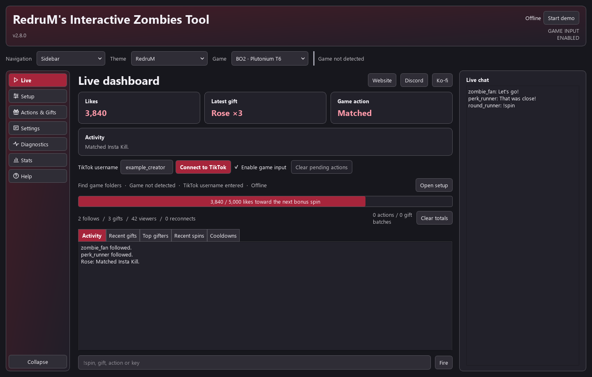
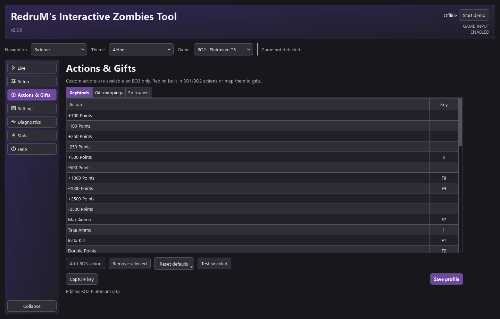
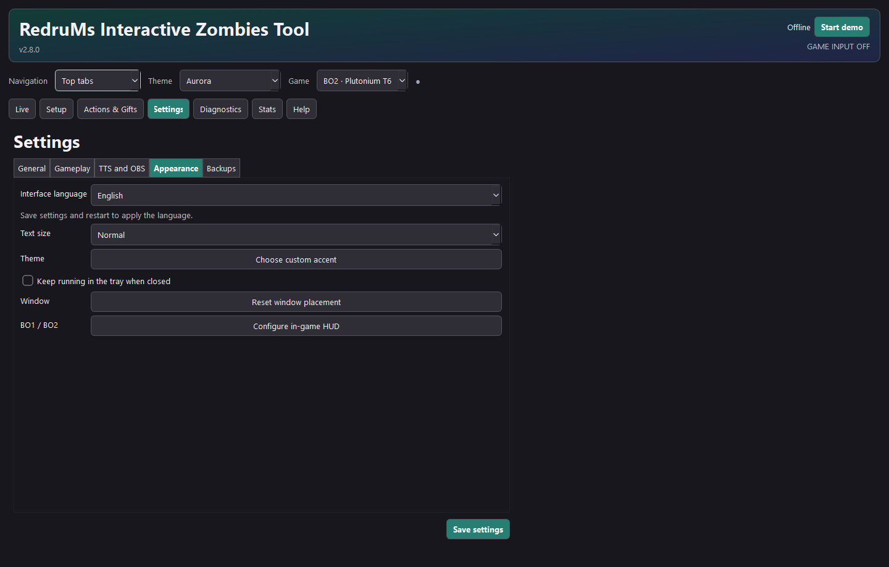
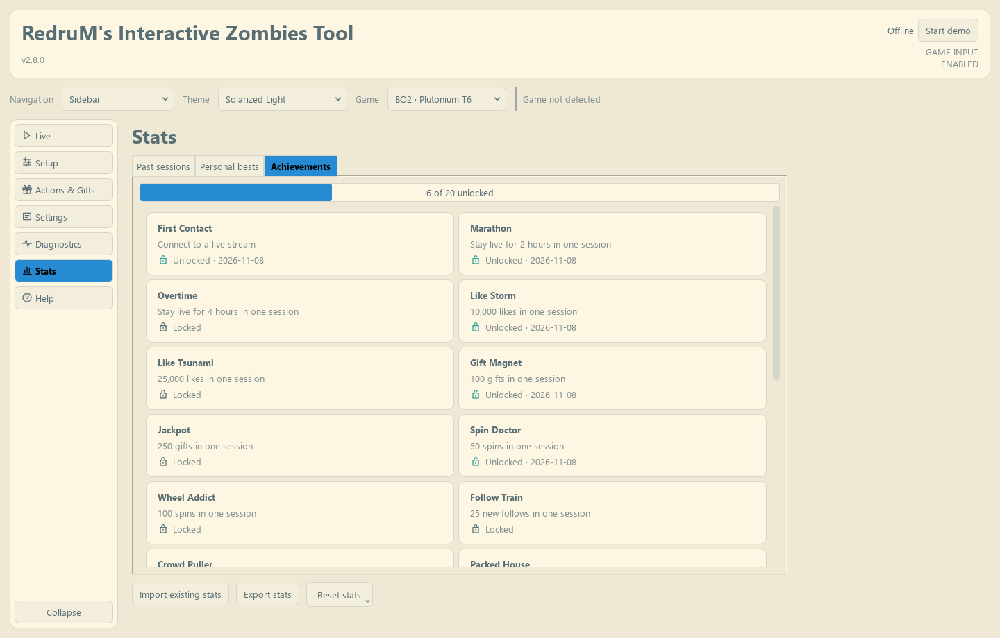
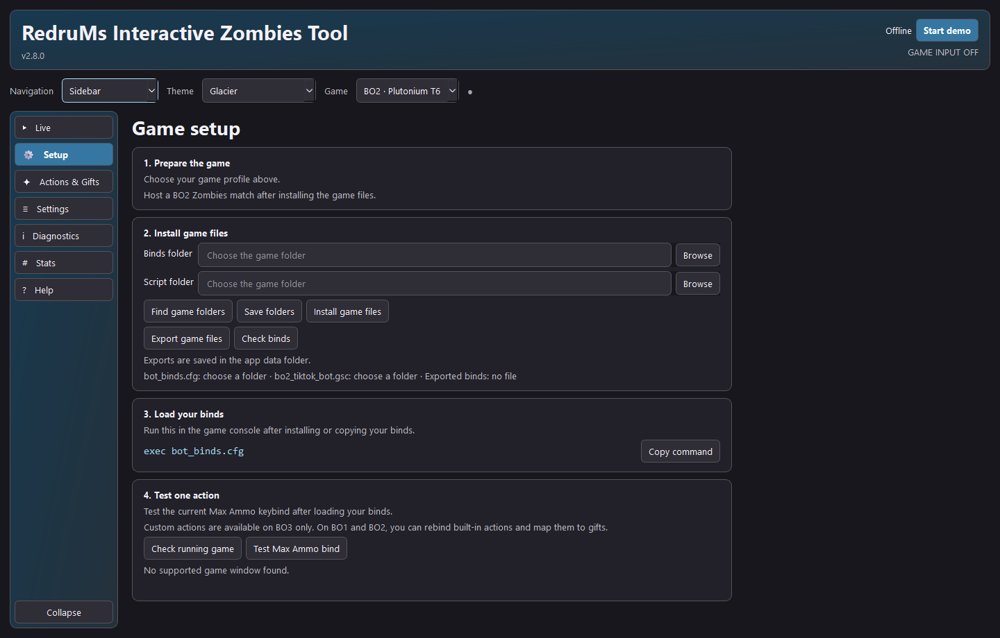

# RedruM's Interactive Zombies Tool

**Version** 2.8.0 &nbsp;|&nbsp; **Windows** &nbsp;|&nbsp; **Developer** RedruM &nbsp;|&nbsp; **Free forever**

[Website](https://redrumtools.com/) · [Download](https://github.com/RedruM-AU/RedruMs_Interactive_Zombies_Tool/releases/latest) · [Discord](https://discord.gg/VFeZVGtBA7)

---

## ❓ What Is This?

Connect TikTok LIVE to Call of Duty Zombies. Viewers can earn points with likes, trigger in-game effects with gifts, or type `!spin` to roll a weighted effect wheel.

---

## 🎮 Supported Games

| Game | Platform | Game console command |
|---|---|---|
| Black Ops 3 Zombies | Steam | `/exec binds.cfg` |
| Black Ops 2 Zombies | Plutonium T6 | `exec bot_binds.cfg` |
| Black Ops 1 Zombies | Plutonium T5 | `exec pluto_t5_binds.cfg` |

Each game has its own profile. **Game detected** beside the profile selector means the app found the selected game's window.

---

## ⚡ Features

### Live Interaction

- See chat, likes, viewers, follows, recent gifts, top gifters and spin cooldowns on **Live**.
- The Live dashboard shows your game file status, whether the game was detected, and whether TikTok is connected.
- Map gifts to actions and set like rewards, follow rewards, bonus spins and cooldowns.
- Use **Start demo** to test sample events offline. With **Enable game input** on, switch back to Zombies within three seconds.

### Actions & Gifts

- Edit **Keybinds**, **Gift mappings** and the **Spin wheel** in one place.
- Capture keys, check conflicts, search the gift catalog and see the wheel's base odds. Use **Gift details** to edit the selected gift's trigger and TikTok ID.
- Add custom console commands for BO3. BO1 and BO2 profiles use their built-in actions.

### Settings

- Choose a collapsible sidebar or top tabs, adjust text size, and pick from dark, light and gradient themes.
- Set up Windows voice callouts, OBS text files and optional Spotify track display.
- Save presets and back up settings, profiles and stats.

### Stream Extras

- Review session history, personal bests and 20 achievement cards in **Stats**, with unlock dates and progress for tracked goals.
- BO1 and BO2 include a configurable zombie counter and a small website watermark. Hosts can enter `say !redrumhud` to adjust the HUD for the current match.

---

## 📦 Installation

1. Download the v2.8.0 ZIP from [Releases](https://github.com/RedruM-AU/RedruMs_Interactive_Zombies_Tool/releases).
2. Close the game and the tool, including its tray icon. Unzip the download and run the Setup executable.
3. Open the tool. Compatible v2.7.0 settings, profiles, presets and stats carry over. If the tool offers **Update game files**, accept it with the game closed.

Already on 2.8.0? Download the refreshed ZIP, close the app, and run Setup again. Your saved settings carry over.

The guided tour opens on first launch. Replay it from **Help > Start guided tour**.

If you use OBS text sources from 2.7.0, open **Settings > TTS and OBS > Copy OBS folder path** and point those sources to the new folder.

## 🛠️ Game Setup

1. Select your game. If you customise keys or gifts, save them in **Actions & Gifts**. Open **Setup**, click **Find game folders**, then **Install game files**.
2. After installing the game files, start a Zombies match. On Plutonium, host the match and open the console with the key below Esc. On BO3, load the Sphynx mod and press tilde (~) to open the console. Run the command and close the console.
3. Use windowed or borderless display mode.
4. Click **Test Max Ammo bind** with game input enabled and return to the game within three seconds. Look for an ammo refill or Max Ammo message. If it works, tick **I saw Max Ammo in the game** and select **Next: Connect to TikTok**.
5. On **Live**, enter your TikTok username. Start your stream, then click **Connect to TikTok**. Game input is enabled by default. Live and Demo only send keys when the app verifies the selected game window. Turn game input off to preview events.

## 🎮 How Viewers Interact

| Event | What happens |
|---|---|
| Likes | Earn points or trigger bonus spins at your configured thresholds |
| Gifts | Trigger the mapped action |
| `!spin` in chat | Rolls an effect from your weighted wheel, subject to cooldowns |

Change rewards and cooldowns in **Settings > Gameplay**.

---

## 🔍 Troubleshooting

<b>Game actions are missing or a bind changed</b>

- Check the game profile, the game window, and **Enable game input**.
- If you changed a key, click **Save profile**, reinstall the game files, and run the console command again.
- Use **Find game folders** if Setup highlights a folder in red. Export and bind checks are under **Show advanced tools**. Restart the match if you replaced a Plutonium script.

<b>TikTok connection or voice problems</b>

- Make sure you're already live on TikTok and have entered the correct username.
- For speech, check **Mute speech**, your selected voice and the volume under **Settings > TTS and OBS**. Use **Test voice** to check playback.
- For a bug report, use **Copy diagnostics** or save the session log from **Diagnostics**. Include your game, app version and the action that failed.

## ❌ Uninstall

Open **Windows Settings > Apps**, find **RedruM's Interactive Zombies Tool**, and choose **Uninstall**. Saved settings and stats are kept for a future reinstall.

---

## 💡 Why I Made This

I built this for my own interactive BO3 Zombies streams while teaching myself to program. It's free forever so anyone can try interactive streaming.

## 📬 Contact

| Platform | Link |
|---|---|
| Website | [redrumtools.com](https://redrumtools.com/) |
| Discord | [RedsHUB](https://discord.gg/VFeZVGtBA7) |
| TikTok | [@redrum.au](https://tiktok.com/@redrum.au) |
| Support development | [Ko-fi](https://ko-fi.com/redrumau) |

See [CHANGELOG.md](CHANGELOG.md) for the full list of changes.
